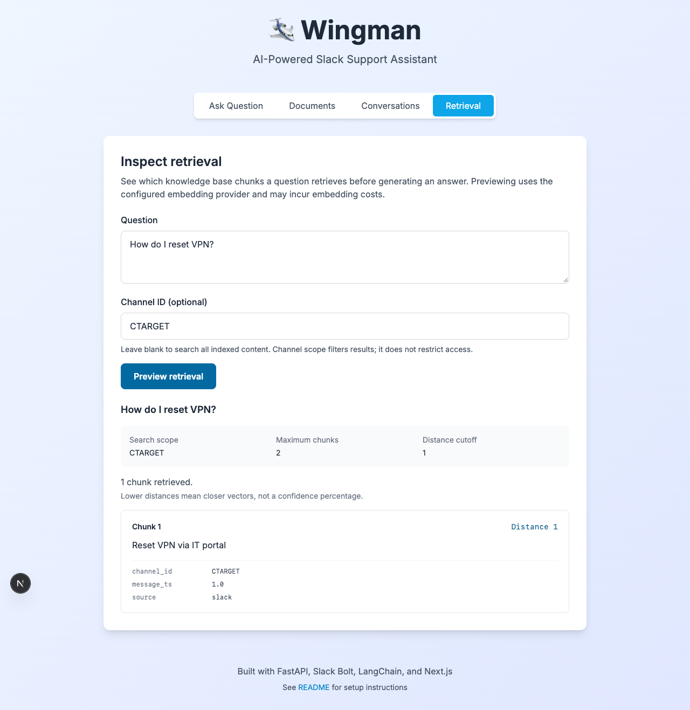

# Retrieval tuning

Wingman retrieves up to `RETRIEVAL_TOP_K` chunks, defaulting to 5. A request with
a channel ID searches only that channel before applying the limit. An unscoped
request searches the whole collection.

Documents are split into overlapping character windows. `CHUNK_SIZE` must be
positive, and `CHUNK_OVERLAP` must be non-negative and smaller than `CHUNK_SIZE`.
Invalid settings are rejected at startup, before indexing can begin. Splitting
stops when a chunk reaches the end of the content; it does not index redundant
trailing overlap fragments. Existing stored fragments are not removed by this
change. Saved document retries described below replace chunks carrying their
document ID. Unowned historical chunks need a collection rebuild from their
original sources.

Set `RETRIEVAL_MAX_DISTANCE` to exclude weak matches from the retrieved context.
Leave it unset to keep all top-k matches, which preserves the default behaviour.
Restart the backend and bot after changing the setting.

```sh
RETRIEVAL_TOP_K=5
RETRIEVAL_MAX_DISTANCE=0.5
```

The cutoff is inclusive. A chunk with distance equal to the cutoff is kept.
Zero is valid and keeps only chunks with zero distance. Negative values,
infinity and NaN are rejected at startup.

Distances are raw Chroma distances, with lower values indicating closer vectors.
Wingman's default collection uses squared L2 distance. Values depend on the
embedding model and collection metric, so `0.5` is an example, not a recommended
threshold. Calibrate the cutoff against representative questions and known
relevant chunks before enabling it. Changing the embedding model or collection
metric requires recalibration.

The shared vector store returns each chunk's distance alongside its content and
metadata. Filtering applies to both API questions and Slack job payloads. Raw
distances are internal retrieval diagnostics; the public answer and source
schemas remain unchanged. Operator rules still bypass retrieval.

If every chunk is excluded, generation receives empty retrieved context. Pi
conversation history can still contribute to an answer. This setting does not
implement a refusal policy or guarantee that an answer is grounded.

## Preview selected chunks

`POST /api/retrieval/preview` shows the chunks selected by the shared vector
store without generating an answer, running operator rules or enqueuing a Pi
job. It uses the same channel scope, top-k and distance cutoff as questions.
The request requires a non-blank `question`; `channel_id` is optional and must
be non-blank when supplied. Surrounding whitespace is trimmed.

```sh
curl -sS http://localhost:8000/api/retrieval/preview \
  -H 'Content-Type: application/json' \
  -d '{"question":"How do I reset VPN?","channel_id":"CTARGET"}'
```

The response includes the normalised question and channel, `top_k`,
`max_distance` (`null` when unset), and ranked `items`. Each item contains
`content`, source `metadata` and raw Chroma `distance`. An unknown channel, empty
collection or cutoff excluding every match returns HTTP 200 with an empty
`items` list. Retrieval failures return HTTP 503. Invalid input returns HTTP 422.

Use the preview to inspect source coverage and calibrate a cutoff against known
questions. It reports the current retrieval policy; it does not override that
policy per request or evaluate answer quality. Previewing still invokes the
configured embedding provider for the query, so it can incur embedding costs.
Like the existing document and message endpoints, this endpoint has no built-in
authentication. Keep the management API behind trusted access controls. Omitting
the channel searches all indexed content; a supplied channel is a search filter,
not an authorisation check. The response contains full chunk text.

The dashboard's **Retrieval** tab calls this endpoint on submission. Enter a
question and optionally a channel ID to inspect ranked chunk text, source
metadata and raw distances alongside the effective top-k and cutoff. An empty
channel searches all indexed content. The tab reports empty results and offers
a retry after failures. Editing either input clears the previous results, and
leaving the tab cancels the pending browser request. It does not generate an
answer or send a Slack message. Cancelling the browser request does not
guarantee that an embedding request already started by the backend is cancelled.



The screenshot uses local fixture data with fixed embeddings, a channel scope
of `CTARGET` and a distance cutoff of 1. It contains no real workspace content.
The [narrow screen capture](images/retrieval-preview-mobile.png) shows the same
result at a width of 390 pixels.

## Retry saved document indexing

In the dashboard, open **Documents**, select a saved document and choose
**Re-index document**. Its content stays visible while indexing runs. The action
shows success or a retryable error and does not create another document. The
list shows saved records, not a persistent indexing status. Leaving the detail
view stops waiting for the result; work already started on the backend may still
finish. The configured embedding provider can charge for this operation.

`POST /api/documents/{document_id}/index` indexes the saved title, content and
source without creating or modifying a database record. Find the ID with
`GET /api/documents`. A missing record returns HTTP 404; invalid legacy title,
content or source fields return HTTP 422 before indexing starts.

```sh
curl -sS -X POST http://localhost:8000/api/documents/1/index
```

Success returns HTTP 200 with `id` and `message`. Indexing failures return HTTP
503 with `detail.message` and `detail.document_id`, so the same record can be
retried after the cause is fixed. `POST /api/documents` uses the same indexing
path. If saving succeeds but indexing fails, it now returns this HTTP 503 shape
with the saved ID. Retry the index endpoint instead of posting the document
again, which would create a separate record.

API-created and retried documents use stable IDs for each chunk and include
`document_id` in retrieval metadata. Repeated indexing replaces their chunks.
Changing chunk settings and retrying removes obsolete owned chunks after the
new chunks are stored successfully. Embedding failures leave existing chunks
available; a cleanup failure may leave a mix of old and new chunks until a
successful retry. Database storage and vector indexing are separate operations,
not an atomic transaction.

Chunks belonging to other document IDs, Slack messages, and legacy chunks
without a document ID are left alone. Retrying a legacy document can therefore
leave historical duplicates. Titles and sources are not unique identities, so
automatic legacy cleanup would risk deleting another document. File indexing
without a saved document ID retains its existing behaviour.

This endpoint calls the configured embedding provider, but does not fetch from
Slack or generate an answer. Keep it behind the same trusted access controls as
the other management endpoints. The offline tests use temporary local Chroma
and fixed embeddings; the recovery transcript is included in the backend gate
output when run with `PYTEST_ADDOPTS=-rP`.

## Delete a saved document

`DELETE /api/documents/{document_id}` removes the document's owned Chroma chunks,
then its saved database record. Success returns HTTP 200 with `id` and
`message`. The record disappears from document lists and detail reads. Deleting
the same ID again returns HTTP 404, as does re-indexing it. A missing record
returns HTTP 404 without accessing Chroma; a non-integer ID returns HTTP 422.
This API action has no dashboard button yet.

```sh
curl -sS -X DELETE http://localhost:8000/api/documents/1
```

Only chunks with matching numeric `document_id` metadata are removed. Other
documents, including those with identical titles and sources, Slack chunks, and
historical chunks without an owner are preserved. Legacy unowned chunks can
therefore remain searchable after deletion. Rebuild them from their original
sources to remove them safely. Documents that were saved but never indexed can
also be deleted, including legacy records with invalid content.

Failures return HTTP 503 with `detail.message` and `detail.document_id` without
exposing provider or database details. Vector deletion runs first; on failure,
the database record is retained for retry. If database removal then fails, the
database transaction is rolled back, but removed chunks cannot be restored
automatically. Retry the same DELETE to finish removal. A lost acknowledgement
can mean a deletion completed even though the caller saw an error; a subsequent
404 means the saved record is already absent. These two stores do not form an
atomic transaction.

Avoid overlapping deletion with indexing of the same document. Existing index
requests can still write chunks after deletion; this API does not coordinate
concurrent workers or implement tombstones. It does not remove content from Pi
history or previous answers. Keep this destructive management endpoint behind
trusted access controls, like the existing unauthenticated document endpoints.
Deletion makes no embedding, model or Slack requests. Chroma must be available
and the shared vector store must be configured, even for an unindexed record.

## Saved Slack threads

Slack thread indexing uses a stable chunk ID built from the channel ID and
message timestamp. Re-indexing the same messages updates their content and
embeddings instead of appending duplicates. This applies to the bot and the
`/api/index/thread` endpoint through their shared RAG engine. Messages without
text or a timestamp are skipped; absent user and thread metadata is omitted.

Existing chunks stored with random IDs are not removed automatically. Rebuild
those collections from their original sources to remove historical duplicates.
Re-indexing only updates messages present in the supplied thread; it does not
remove chunks for deleted Slack messages or handle Slack edit/delete events.

`POST /api/index/thread?channel_id=...&thread_ts=...` indexes the saved root
message and its saved replies in timestamp order, within the requested channel.
The root is included even when its `thread_ts` is absent. A root-only thread is
valid; saved replies can also be indexed when the root was never stored. If
neither the root nor any replies are saved in that channel, the API returns
HTTP 404. It does not fetch missing messages from Slack.

The fixture tests use temporary local Chroma storage and fixed embeddings.
They make no embedding, model or Slack calls. To show the captured transcript
with the query, chunks and distances before and after filtering or repeated
thread indexing, run the backend
gate with captured output for passing tests enabled.

```sh
PYTEST_ADDOPTS=-rP mise run test-backend
```
